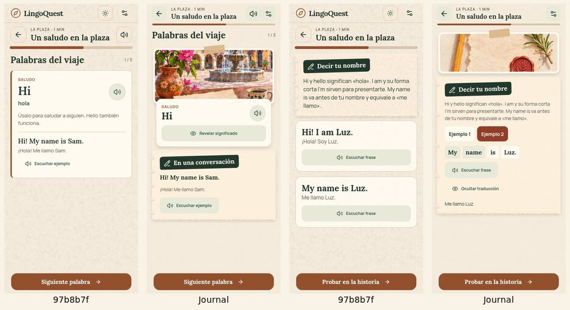

# Cuaderno ilustrado de LingoQuest

[English](UI_JOURNAL.md)

El diseño presenta el diálogo como una postal, el vocabulario como una ilustración con una ficha de recuerdo y la gramática como un cuaderno con ejemplos que se pueden seleccionar y escuchar. Las actividades de escucha, lectura, escritura y práctica oral agrupan las instrucciones y sus controles en una sola superficie. El atlas usa los datos de las 20 etapas y el pasaporte recoge el sello y el recuerdo del capítulo.

## Sistema visual

- El papel es el fondo, la hoja clara agrupa información y el verde sirve para controles secundarios y estados de avance. El terracota destaca la acción principal. Cada tema conserva sus propios colores de texto y superficie.
- Lora marca la jerarquía editorial y Manrope se usa para instrucciones, controles y opciones. Los títulos cortos, el halo de foco y las etiquetas accesibles se mantienen al navegar.
- `JournalArt`, `JournalLeaf`, `JournalSpread` y `Notebook` reúnen imágenes, cinta, bordes de papel, sombras y títulos. Las ilustraciones originales se generaron para el proyecto con ImageGen y se recortaron y comprimieron como JPEG incluidos para uso sin conexión.
- La traducción del vocabulario y las opciones del taller se activan con controles reales. El taller de parejas y completar frases es práctica libre. Las misiones, repasos y desafíos siguen usando su motor de aprendizaje.

## Entradas de la aplicación

`App.tsx` abre la bienvenida, el inicio, el atlas, el pasaporte, la guía, el repaso rápido y el perfil. Los puntos de guardado de las misiones controlan `TravelFlow.tsx`. La prueba de nivel y la pronunciación usan el mismo marco compacto, y la guía ofrece ejercicios libres. `ExerciseInput.tsx` sigue siendo el control de respuesta compartido por las misiones y la prueba de nivel. La pantalla de desafíos conserva sus controles y ajustes de tiempo.

## Capturas comparadas

Capturas de Chromium en una ventana móvil de 390 × 844 px, salvo la prueba de texto ampliado a 320 px. El punto de comparación es el commit `97b8b7f`. Las capturas de ejercicios y del pasaporte proceden de recorrer las tres misiones desde Inicio con Chromium sin conexión, incluida la recuperación del borrador tras recargar. Los cuadros de parejas y completar del taller son nuevos.

| Pantalla                                  | Antes                                             | Después                                          |
| ----------------------------------------- | ------------------------------------------------- | ------------------------------------------------ |
| Inicio                                    | [Ver](ui-journal/before/01-home.jpg)              | [Ver](ui-journal/after/01-home.jpg)              |
| Mapa del mundo                            | [Ver](ui-journal/before/02-world-map.jpg)         | [Ver](ui-journal/after/02-world-map.jpg)         |
| Diálogo                                   | [Ver](ui-journal/before/03-dialogue.jpg)          | [Ver](ui-journal/after/03-dialogue.jpg)          |
| Vocabulario                               | [Ver](ui-journal/before/04-vocabulary.jpg)        | [Ver](ui-journal/after/04-vocabulary.jpg)        |
| Taller de gramática                       | [Ver](ui-journal/before/05-grammar.jpg)           | [Ver](ui-journal/after/05-grammar.jpg)           |
| Escritura y borrador                      | [Ver](ui-journal/before/06-writing.jpg)           | [Ver](ui-journal/after/06-writing.jpg)           |
| Respuesta incorrecta                      | [Ver](ui-journal/before/07-incorrect.jpg)         | [Ver](ui-journal/after/07-incorrect.jpg)         |
| Respuesta correcta                        | [Ver](ui-journal/before/08-correct.jpg)           | [Ver](ui-journal/after/08-correct.jpg)           |
| Práctica oral                             | [Ver](ui-journal/before/09-speaking.jpg)          | [Ver](ui-journal/after/09-speaking.jpg)          |
| Misión completada                         | [Ver](ui-journal/before/10-completion.jpg)        | [Ver](ui-journal/after/10-completion.jpg)        |
| Comprensión auditiva                      | [Ver](ui-journal/before/11-listening.jpg)         | [Ver](ui-journal/after/11-listening.jpg)         |
| Reordenar una oración                     | [Ver](ui-journal/before/12-reorder.jpg)           | [Ver](ui-journal/after/12-reorder.jpg)           |
| Lectura y opción múltiple                 | [Ver](ui-journal/before/13-reading-choice.jpg)    | [Ver](ui-journal/after/13-reading-choice.jpg)    |
| Pasaporte                                 | [Ver](ui-journal/before/14-passport.jpg)          | [Ver](ui-journal/after/14-passport.jpg)          |
| Repaso rápido                             | [Ver](ui-journal/before/15-review.jpg)            | [Ver](ui-journal/after/15-review.jpg)            |
| Niveles de desafío                        | [Ver](ui-journal/before/16-challenges.jpg)        | [Ver](ui-journal/after/16-challenges.jpg)        |
| Completar en el desafío                   | [Ver](ui-journal/before/17-advanced-cloze.jpg)    | [Ver](ui-journal/after/17-advanced-cloze.jpg)    |
| Relacionar vocabulario                    | —                                                 | [Ver](ui-journal/after/18-matching.jpg)          |
| Completar en el taller                    | —                                                 | [Ver](ui-journal/after/19-cloze.jpg)             |
| Perfil                                    | [Ver](ui-journal/before/20-profile.jpg)           | [Ver](ui-journal/after/20-profile.jpg)           |
| Configuración                             | [Ver](ui-journal/before/21-settings.jpg)          | [Ver](ui-journal/after/21-settings.jpg)          |
| Tema oscuro                               | [Ver](ui-journal/before/22-dark.jpg)              | [Ver](ui-journal/after/22-dark.jpg)              |
| 320 px con texto ampliado en el navegador | [Ver](ui-journal/before/23-narrow-large-text.jpg) | [Ver](ui-journal/after/23-narrow-large-text.jpg) |

## Límites de la verificación

El atlas muestra las 20 etapas y los desafíos conservan los 13 niveles. El contenido publicado permite jugar el primer capítulo y los tres niveles de desafío asociados. Las capturas documentan la interfaz Web móvil. El tamaño de texto se amplió en Chromium y las pruebas de teclado simularon la superposición y el redimensionamiento de la ventana. La escala de fuente del sistema y la interacción del teclado en un teléfono Android requieren comprobación en un dispositivo.
