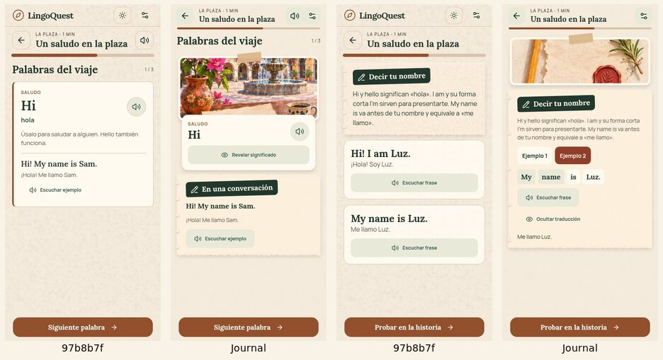

# LingoQuest illustrated journal

[Español (Latinoamérica)](UI_JOURNAL.es-419.md)

Dialogue uses postcards, vocabulary pairs an illustration with a recall slip, and grammar puts selectable and playable examples on a notebook page. Listening, reading, writing, and speaking activities group instructions and controls on one surface. The atlas uses the 20-stage route data, and the passport collects the chapter stamp and journal entry.

## Visual system

- The page uses cream paper and light leaves to group information. Forest green marks secondary controls and progress. Terracotta marks the primary action. Each theme supplies its own text and surface colors.
- Lora sets the editorial hierarchy, and Manrope carries instructions, controls, and options. Short headers, keyboard focus, and accessible labels support navigation.
- `JournalArt`, `JournalLeaf`, `JournalSpread`, and `Notebook` provide reusable artwork, tape, deckled edges, shadows, and titles. Original illustrations were generated for this project with ImageGen, then cropped and compressed as bundled JPEGs for offline use.
- Vocabulary translations and workshop choices use real interactive controls. Matching and fill-in in the workshop are free practice. Missions, reviews, and challenges use the learning engine.

## App entry points

`App.tsx` opens the welcome, home, atlas, passport, guide, quick review, and profile. Mission checkpoints drive `TravelFlow.tsx`. Placement and pronunciation use the same compact frame, while the guide exposes free workshop exercises. `ExerciseInput.tsx` remains the shared answer control for mission and placement activities. The challenge screen retains its own run controls and timeout settings.

## Screenshot comparison

Captured in Chromium at 390 × 844 px except the 320 px enlarged-text check. The baseline is commit `97b8b7f`. Exercise and passport captures came from playing the three missions from Home with Chromium offline, including draft restoration after reload. The matching and fill-in workshop views are new.

| Screen                            | Before                                             | After                                             |
| --------------------------------- | -------------------------------------------------- | ------------------------------------------------- |
| Home                              | [View](ui-journal/before/01-home.jpg)              | [View](ui-journal/after/01-home.jpg)              |
| World map                         | [View](ui-journal/before/02-world-map.jpg)         | [View](ui-journal/after/02-world-map.jpg)         |
| NPC dialogue                      | [View](ui-journal/before/03-dialogue.jpg)          | [View](ui-journal/after/03-dialogue.jpg)          |
| Vocabulary                        | [View](ui-journal/before/04-vocabulary.jpg)        | [View](ui-journal/after/04-vocabulary.jpg)        |
| Grammar workbench                 | [View](ui-journal/before/05-grammar.jpg)           | [View](ui-journal/after/05-grammar.jpg)           |
| Writing and saved draft           | [View](ui-journal/before/06-writing.jpg)           | [View](ui-journal/after/06-writing.jpg)           |
| Incorrect answer                  | [View](ui-journal/before/07-incorrect.jpg)         | [View](ui-journal/after/07-incorrect.jpg)         |
| Correct answer                    | [View](ui-journal/before/08-correct.jpg)           | [View](ui-journal/after/08-correct.jpg)           |
| Speaking studio                   | [View](ui-journal/before/09-speaking.jpg)          | [View](ui-journal/after/09-speaking.jpg)          |
| Mission completion                | [View](ui-journal/before/10-completion.jpg)        | [View](ui-journal/after/10-completion.jpg)        |
| Listening                         | [View](ui-journal/before/11-listening.jpg)         | [View](ui-journal/after/11-listening.jpg)         |
| Sentence rearrangement            | [View](ui-journal/before/12-reorder.jpg)           | [View](ui-journal/after/12-reorder.jpg)           |
| Reading and multiple choice       | [View](ui-journal/before/13-reading-choice.jpg)    | [View](ui-journal/after/13-reading-choice.jpg)    |
| Passport                          | [View](ui-journal/before/14-passport.jpg)          | [View](ui-journal/after/14-passport.jpg)          |
| Quick review                      | [View](ui-journal/before/15-review.jpg)            | [View](ui-journal/after/15-review.jpg)            |
| Challenge levels                  | [View](ui-journal/before/16-challenges.jpg)        | [View](ui-journal/after/16-challenges.jpg)        |
| Challenge fill-in                 | [View](ui-journal/before/17-advanced-cloze.jpg)    | [View](ui-journal/after/17-advanced-cloze.jpg)    |
| Vocabulary matching               | —                                                  | [View](ui-journal/after/18-matching.jpg)          |
| Workshop fill-in                  | —                                                  | [View](ui-journal/after/19-cloze.jpg)             |
| Profile                           | [View](ui-journal/before/20-profile.jpg)           | [View](ui-journal/after/20-profile.jpg)           |
| Settings                          | [View](ui-journal/before/21-settings.jpg)          | [View](ui-journal/after/21-settings.jpg)          |
| Dark theme                        | [View](ui-journal/before/22-dark.jpg)              | [View](ui-journal/after/22-dark.jpg)              |
| 320 px with enlarged browser text | [View](ui-journal/before/23-narrow-large-text.jpg) | [View](ui-journal/after/23-narrow-large-text.jpg) |

## Paper finishes

Postcards use scalloped edges and a lifted shadow. Notebooks use irregular edges and punched binding holes. Illustrated postage stamps have perforated borders and sit on the postcard as separate pieces. A tighter contact shadow and a softer drop shadow separate overlapping pieces.

[Compare the dialogue and writing screens before and after the paper update](ui-journal/paper-finishes.jpg).

Postcard edges frame illustrations, map panels, and settings sheets. Notebook edges mark lesson notes, writing fields, and feedback. Perforated postage paper distinguishes smaller labels and collectibles. Buttons and answer choices keep their existing appearance.

[See the shared paper frames in the atlas, writing exercise, passport, and settings](ui-journal/shared-frames.jpg).

## Verification limits

The atlas exposes all 20 stages and the challenges retain 13 levels. The published content makes the first story chapter and its three associated challenge levels playable. The captures document mobile Web. Text enlargement was tested in Chromium, and the keyboard scenarios simulate overlay and window resizing. System font scaling and keyboard behavior on an Android phone require a device check.
